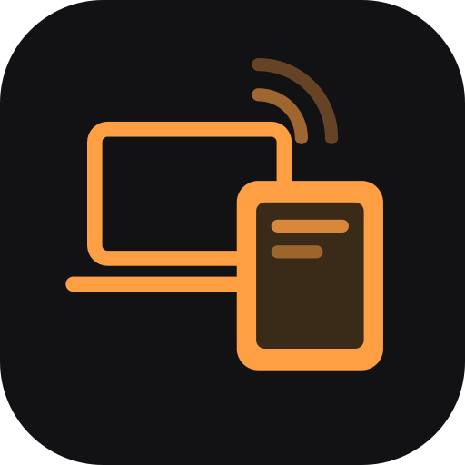
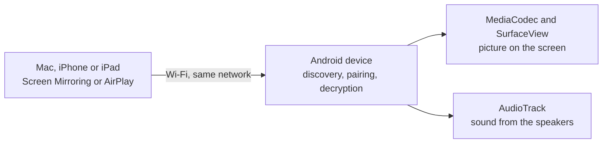

<div align="center">
  
  <h1>Second Display</h1>
  <p><strong>Turn an Android tablet or phone into a wireless display and speaker for your Mac, iPhone and iPad.</strong></p>
  <p>AirPlay-compatible screen mirroring &amp; extended display receiver for Android 11+.</p>
  <p><a href="https://github.com/swiderekart-max/second-display/releases/latest"><strong>⬇ Download the latest release (APK)</strong></a> · <a href="https://github.com/swiderekart-max/second-display/releases">All releases</a></p>
</div>

---

## What it is

Second Display makes an Android device show up in **Control Center → Screen Mirroring** on a Mac, iPhone or iPad. The Mac can use it as an **extended display** or a **mirror**, with sound. Nothing needs to be installed on the sender.

It is an ordinary app: **no root, no cloud, no account**. It only talks to Apple devices on your local Wi-Fi.

Second Display is a fork of [Wormhole Display](https://github.com/pgodlews/wormhole-display) by Piotr Godlewski, which was built for Meta Portal devices (Android 9-10). This fork targets current Android phones and tablets instead; Portals are not supported by this build. See [What this fork changes](#what-this-fork-changes).

Second Display is an independent community project and is not affiliated with Apple; see the legal section below.

---

## Features

- **Shows up like any AirPlay display**, under a name you choose.
- **Extended display or mirror**: macOS can use the device as a second screen.
- **Preferred resolution**: offer the sender the native panel size, a common size (1920×1200, 1920×1080, 1680×1050, 1600×900, 1440×900, 1280×720) or 80 / 64 / 50 % of the panel. Lower sizes are lighter on Wi-Fi. Sizes larger than the panel are hidden; sizes with a different aspect are letterboxed, never stretched.
- **Settings during a session**: long press on the mirrored picture. Stream stats and speaker output apply at once; resolution and HEVC end the session, because the sender only reads them when it connects.
- **Survives Wi-Fi hiccups**: a low-latency Wi-Fi lock keeps the radio awake, and a 90-frame decoder buffer absorbs the burst a sender delivers after a stall, catching up without replaying it.
- **Hardware video decoding**: H.264, with experimental HEVC for senders that choose it.
- **Sound through the device**, mutable from the dashboard.
- **AirPlay speaker (audio-only)** from an iPhone or iPad, with cover art, title and progress full screen.
- **Opens when you connect**: the receiver stays available in the background and brings itself full screen when a stream starts. It can also start at boot.
- **Portrait, landscape or auto** orientation.
- **Dashboard and stats**: network details, recent connections and an optional on-screen stats overlay (FPS, bitrate, codec).

---

## Requirements

| | |
|---|---|
| **Android** | 11 or newer (API 30+); built for Android 15 (targetSdk 35) |
| **CPU** | 64-bit ARM (`arm64-v8a`), i.e. practically every phone and tablet from recent years |
| **Network** | Device and sender on the **same Wi-Fi network** (5 GHz strongly recommended) |
| **Sender** | Mac, iPhone or iPad with Screen Mirroring |

Tested on a Xiaomi Pad (Android 14, HyperOS, 2000×1200) with a MacBook as the sender. Android 15 and 16 are supported by the code but not yet tested on a device; reports are welcome.

---

## Installation

### 1. Install the APK

Download `second-display.apk` from the [latest release](https://github.com/swiderekart-max/second-display/releases/latest) (or build it yourself, see [Building from source](#building-from-source)), then either open it on the device or install it over USB:

```bash
adb install -r second-display.apk
```

Release APKs are signed with the certificate `CN=Second Display, O=swiderekart-max`, SHA-256 `50:B3:E7:D4:AE:EF:85:2C:50:B8:CA:19:37:BE:E0:E2:F2:06:17:9B:74:DF:57:D9:40:19:49:CB:91:25:B6:EA`. Check with `apksigner verify --print-certs second-display.apk`.

Google Play Protect may warn about an app from an unknown source and block the install. For a sideloaded build you trust, confirm on the device, or for an `adb` install switch off **Verify apps over USB** in Developer options for the duration of the install and switch it back on afterwards.

### 2. First launch

Open **Second Display** and:

1. **Allow notifications** when asked. The receiver runs as a foreground service; without the permission it still works, but its notification is hidden.
2. Tap **Allow** next to *Auto-open on connect* and turn on **Display over other apps**. Android only lets the app bring itself to the front for an incoming stream with that permission.
3. Leave **Run in Background** and **Start on Boot** on.

### 3. Keep it alive (Xiaomi, Samsung, Huawei, OnePlus and others)

Several manufacturers stop background apps aggressively. On those devices:

- In **Settings → Apps → Second Display**: turn on **Autostart** and set battery use to **No restrictions**.
- **Lock the app in Recents** (long press its card, tap the padlock), so "clear all" does not close it.

---

## Connecting

### From a Mac

1. Mac and device on the same Wi-Fi network.
2. **Control Center → Screen Mirroring**, pick the device.
3. In **System Settings → Displays**, choose **Extended display** or **Mirror**.

For crisp text, see the [text sharpness guide](docs/macos-text-sharpness.md).

### From an iPhone or iPad

**Control Center → Screen Mirroring**, pick the device.

### Ending a session

Press **Back** or **Home** on the device, tap **Disconnect** in the in-session settings, or stop Screen Mirroring on the sender. Installing an update also ends a running session.

---

## Settings

On the dashboard (when nothing is connected), under **Controls & Playback**:

| Setting | What it does |
|---|---|
| Screen Orientation | Landscape, portrait, or auto (devices with a rotation sensor) |
| Preferred Resolution | Size offered to the sender; tap the value to open the list |
| Speaker Output | Play sound through the device speakers |
| H.265 video | Offer HEVC; the sender decides whether to use it. A Mac on Wi-Fi often stays on H.264 |
| Telemetry Overlay | FPS, bitrate, resolution and codec in the top-left corner |
| Run in Background / Start on Boot | Keep the receiver discoverable |
| Bonjour Service Name | Name shown in Screen Mirroring (default: *Second Display*) |

During a session, **long press on the picture** for stats, speaker, resolution, HEVC and Disconnect.

---

## Troubleshooting

| Symptom | Cause and fix |
|---|---|
| Device not listed in Screen Mirroring | Not on the same network, or the network isolates clients (common on office and guest Wi-Fi). Try **Receiver Service → Restart**. |
| Session drops or the picture stutters | Usually the Wi-Fi link: 2.4 GHz is slow and crowded, and every frame crosses it twice (sender → router → device). Move both to **5 GHz** and/or pick a lower **Preferred Resolution**. |
| Picture freezes after a while, app gone | The system closed it. See [Keep it alive](#3-keep-it-alive-xiaomi-samsung-huawei-oneplus-and-others). |
| Black bars around the picture | The chosen resolution has a different aspect than the panel. Pick **Native** or a percentage. |
| Mac keeps using H.264 with HEVC on | Expected: the sender chooses the codec. |

---

## Building from source

Requirements: **JDK 17**, **Android SDK** with platform 35 and build-tools 35, **NDK 27.3.13750724** and **CMake 3.22.1** (the native AirPlay core is compiled on every build). Prebuilt static OpenSSL and libplist are committed under `app/src/main/cpp/deps/`.

On macOS with Homebrew:

```bash
brew install openjdk@17
brew install --cask android-commandlinetools android-platform-tools
export JAVA_HOME=/opt/homebrew/opt/openjdk@17/libexec/openjdk.jdk/Contents/Home
export ANDROID_HOME=/opt/homebrew/share/android-commandlinetools
sdkmanager --sdk_root=$ANDROID_HOME "platforms;android-35" "build-tools;35.0.0" "ndk;27.3.13750724" "cmake;3.22.1"
```

Build, test and install:

```bash
# A local build is versionCode 1 unless set; use a value above the one installed.
export SECOND_DISPLAY_VERSION_CODE=30003 SECOND_DISPLAY_VERSION_NAME=0.4.0-dev
./gradlew :app:testDebugUnitTest :app:assembleDebug
adb install -r app/build/outputs/apk/debug/app-debug.apk
adb shell am start -n io.github.swiderekartmax.seconddisplay/.MainActivity
```

`./scripts/build.sh` does the same build and copies the APK to `dist/second-display.apk`.

A debug-signed and a release-signed APK cannot replace each other; uninstall first when switching (this resets the receiver identity and the *Display over other apps* grant).

Protocol details, contributor notes and troubleshooting: [AGENTS.md](AGENTS.md) and [docs/architecture.md](docs/architecture.md).

### Releases (GitHub Actions)

Releases are automatic. Every merge to `main` builds, signs and publishes the next version:

| In the merge commit or PR title | Result |
|---|---|
| nothing | patch release, e.g. v0.4.3 → **v0.4.4** |
| `#minor` | **v0.5.0** |
| `#major` | **v1.0.0** |
| `[skip release]` | build and tests only, nothing published |

Pull requests get unit tests and a debug APK artifact. Pushing a `vX.Y.Z` tag by hand still publishes that exact version. Signing uses the repository secrets `SECOND_DISPLAY_KEYSTORE_BASE64`, `SECOND_DISPLAY_KEYSTORE_PASSWORD`, `SECOND_DISPLAY_KEY_ALIAS` and `SECOND_DISPLAY_KEY_PASSWORD`; without them a release fails instead of publishing an unsigned APK.

---

## How it works

Second Display is built on an Android port of [UxPlay](https://github.com/FDH2/UxPlay)'s C core (RTSP/RAOP, pairing, AES decryption and an embedded mDNS responder). UxPlay's desktop GStreamer pipelines are replaced with Android's hardware `MediaCodec` for video and low-latency `AudioTrack` for audio.



See [the architecture notes](docs/architecture.md) for details.

---

## Privacy and security

- The app only communicates with the device that connects to it on the local network: no analytics, crash reporting, ads or external servers. Its only libraries are Jetpack Compose (UI), OpenSSL and libplist (AirPlay protocol).
- It accepts screen-mirroring connections from **any device on your local network, without a PIN or password**. Use it only on networks you trust.

---

## What this fork changes

Compared with [upstream Wormhole Display](https://github.com/pgodlews/wormhole-display):

- **New name and identity**: *Second Display*, application ID `io.github.swiderekartmax.seconddisplay` (installs alongside the original, not over it), new icon.

- **Android 11+ launch crash fixed**: the display was read from the application context, which throws on API 30+.
- **Targets current Android** (minSdk 30, targetSdk 35): notification permission (Android 13), foreground-service type (Android 14), edge-to-edge with hidden system bars (Android 15). Portals (Android 9-10) are no longer supported.
- **Stable on lossy Wi-Fi**: 90-frame decoder buffer (was 12) with catch-up that shows only the newest frame, and a low-latency Wi-Fi lock.
- **Preferred resolution** setting and **in-session settings** on long press.

---

## Legal & Trademark Disclaimers

### Non-Affiliation Disclaimer
**Second Display** is an independent, community-developed open-source software project. It is not manufactured, endorsed, sponsored, affiliated with, or supported by **Apple Inc.**

### Nominative Fair Use
**Apple**, **AirPlay**, **macOS**, **iOS**, **Mac**, **MacBook**, **Retina**, and **Bonjour** are trademarks or registered trademarks of **Apple Inc.** in the United States and other countries. All brand names and trademarks referenced in this repository are used strictly under **Nominative Fair Use** for technical identification and interoperability.

---

## License

Second Display is based on Wormhole Display, copyright © 2026 Piotr Godlewski. Changes in this fork © 2026 their contributors.

Second Display is licensed under the **GNU General Public License v3.0 (GPLv3)**; see [LICENSE](LICENSE). It links and builds upon UxPlay (GPLv3); bundled third-party components keep their own copyrights and licenses, listed in [THIRD_PARTY_NOTICES.md](THIRD_PARTY_NOTICES.md).
